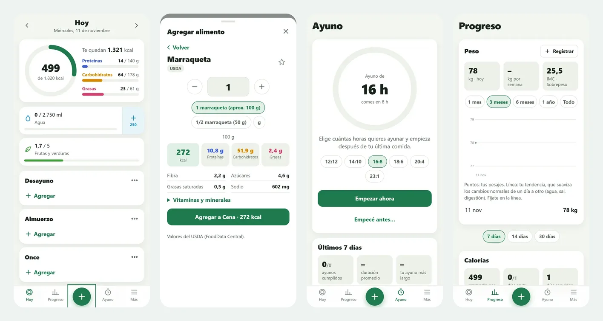
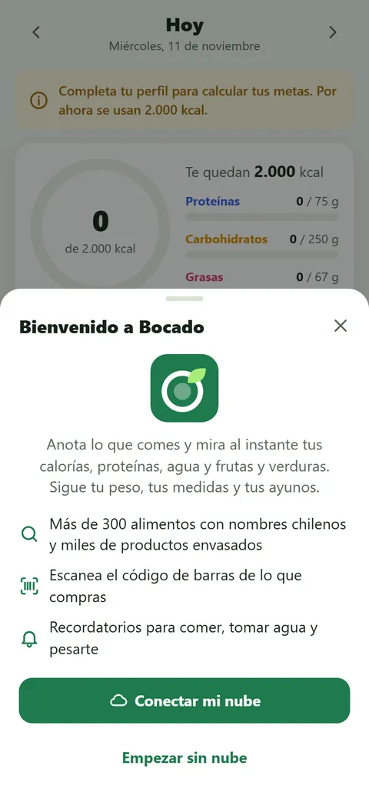
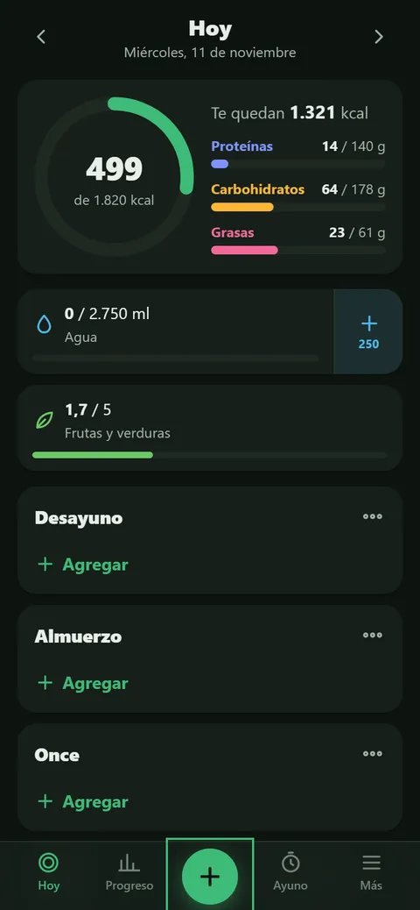

# Bocado

App web para el celular que registra lo que comes —calorías, macros, agua, peso y ayuno— con **alimentos chilenos**, **lector de código de barras** y **funcionamiento sin internet**. Se instala en el iPhone desde Safari y sincroniza los datos con un servidor propio en Cloudflare cuando hay conexión.

**Estado:** prototipo funcional. Falta probar la cámara y las notificaciones en un iPhone real antes de publicarla.



## El problema

Las apps de nutrición conocidas no traen alimentos chilenos (marraqueta, hallulla, productos envasados de Chile), cobran suscripción para lo importante y fallan cuando no hay señal. Bocado parte del teléfono: todo funciona sin conexión y la nube es solo un respaldo y un puente entre dispositivos.

## Funcionalidades

- **Diario por comida** (desayuno, almuerzo, once, cena y colaciones) con calorías, proteínas, carbohidratos y grasas, más fibra, azúcares, grasas saturadas, sodio, colesterol, vitaminas y minerales.
- **Metas calculadas** con la fórmula de Mifflin-St Jeor según sexo, edad, estatura, peso, actividad y objetivo, con ajustes manuales.
- **Base de 327 alimentos con nombres chilenos**, generada desde USDA FoodData Central, y **productos envasados de Chile** desde Open Food Facts.
- **Lector de código de barras** que funciona en el navegador (zxing-wasm), también sin internet.
- **Tus alimentos** copiando la etiqueta (con los sellos «ALTO EN»), **recetas**, **comidas guardadas**, favoritos y recientes.
- **Agua**, **frutas y verduras** (porciones de 80 g), **peso con tendencia**, IMC, medidas y **ayuno intermitente**.
- **Estadísticas** de 7, 14 y 30 días.
- **Recordatorios** en el celular: comidas no anotadas, agua (solo si vas atrasado), pesaje semanal, ayuno cumplido y resumen del día.
- **Respaldo** en archivo JSON y **exportación a Excel**.
- Modo claro y oscuro automático.

| Bienvenida | Hoy, en modo oscuro |
|---|---|
|  |  |

## Tecnologías

| Parte | Tecnología |
|---|---|
| App | HTML, CSS y JavaScript con módulos ES, sin paso de compilación |
| Instalación y modo sin conexión | PWA: Web App Manifest y Service Worker |
| Datos en el teléfono | IndexedDB |
| Servidor | Cloudflare Workers (plan gratuito) |
| Base de datos en la nube | Cloudflare D1 (SQLite) |
| Recordatorios | Cron Trigger cada 5 minutos + Web Push (VAPID, cifrado aes128gcm según RFC 8291) |
| Código de barras | barcode-detector + zxing-wasm |
| Datos de alimentos | USDA FoodData Central y Open Food Facts |
| Pruebas | `node:test` (22 pruebas) |

## Arquitectura

```text
Celular (IndexedDB) ──cambios pendientes──▶ POST /api/sincronizar ──▶ D1 (registros + contador)
        ▲                                                                   │
        └──────────────── cambios nuevos desde el último contador ◀─────────┘

Buscar producto ──▶ GET /api/productos ──▶ Open Food Facts (filtrado a Chile, con caché)

Cron cada 5 min ──▶ ¿qué recordatorio toca según la hora de Chile y los datos del día? ──▶ Web Push
```

- **Offline-first:** todo se guarda primero en el teléfono. Cada cambio queda pendiente hasta subirlo.
- **Sincronización por contador:** el servidor numera cada cambio; el teléfono pide los posteriores al último que vio.
- **Conflictos:** si dos dispositivos cambian el mismo dato, gana el cambio más reciente.
- **Acceso:** una clave propia de la app, con límite de 10 intentos cada 15 minutos.

## Estructura

| Ruta | Qué es |
|---|---|
| `public/` | La app (HTML, CSS, JS, íconos y base de alimentos) |
| `public/js/vistas/` | Pantallas: Hoy, Agregar, Progreso, Ayuno, Más, alimentos propios y recetas |
| `public/js/nutricion.js` | Cálculos: metas, sumas, sellos, tendencia del peso y ayuno |
| `public/js/sync.js` | Sincronización con la nube |
| `public/datos/alimentos.json` | Base de alimentos (la genera `npm run alimentos`) |
| `public/vendor/` | Lector de códigos de barras (copiado con `npm run vendor`) |
| `src/index.js` | Servidor: sincronización, productos envasados y recordatorios |
| `src/recordatorios.js` | Qué recordatorio corresponde y qué dice |
| `src/webpush.js` | Envío de notificaciones Web Push sin librerías |
| `scripts/` | Generación de la base de alimentos, íconos y claves |
| `migrations/` | Estructura de la base de datos |
| `test/` | Pruebas |

## Requisitos

- Node.js 22 o superior (lo exige Wrangler 4).
- Una cuenta gratuita de Cloudflare (solo para publicar).

## Probar en tu computador

```bash
npm install
npm run claves      # crea .dev.vars con claves locales (la clave de la app es: prueba-local)
npm run db:local
npm run dev         # abre http://127.0.0.1:8787 → "Conectar mi nube" → prueba-local
npm test
```

`.dev.vars` y `.env` están en `.gitignore`: nunca se suben.

## Publicar en Cloudflare

1. En Cloudflare: **My Profile › API Tokens › Create Token**, plantilla **Edit Cloudflare Workers** más el permiso **Account › D1 › Edit**.
2. Copia `.env.example` como `.env` y completa el token y tu Account ID.
3. `npx wrangler d1 create bocado` y pega el `database_id` en `wrangler.jsonc`.
4. `npm run db:remota` para crear las tablas.
5. `npm run subir-claves` para subir las claves de las notificaciones.
6. `npx wrangler secret put APP_CLAVE` y escribe la clave con la que entrarás a la app.
7. `npm run publicar`. Al final aparece la dirección, por ejemplo `https://bocado.TU-CUENTA.workers.dev`.
8. En `wrangler.jsonc`, cambia `VAPID_SUBJECT` por esa dirección y vuelve a publicar (Apple lo exige para enviar avisos).

### Instalar en el iPhone

1. Abre la dirección en **Safari**.
2. **Compartir → Agregar a inicio**, con «Abrir como app web» activado.
3. Abre la app desde el ícono, toca **Conectar mi nube** y escribe tu clave.
4. En **Más › Recordatorios**, toca **Activar avisos**.

## Actualizar la base de alimentos

Edita `scripts/alimentos-base.txt` (el formato está explicado al inicio del archivo), descarga **SR Legacy en CSV** desde https://fdc.nal.usda.gov/download-datasets y ejecuta:

```bash
npm run alimentos -- RUTA_A_LA_CARPETA_DEL_CSV
```

## Limitaciones conocidas

- No se ha probado todavía en un iPhone real con la cámara en vivo ni con las notificaciones.
- En iPhone, las notificaciones solo funcionan si la app está instalada en la pantalla de inicio (iOS 16.4 o superior).
- Las porciones chilenas marcadas «aprox.» (marraqueta, hallulla, sopaipilla) son aproximadas.
- Los datos de Open Food Facts los cargan voluntarios y a veces vienen incompletos.
- Si dos dispositivos editan el mismo dato sin conexión, se conserva solo el cambio más reciente.

## Próximas mejoras

- Publicarla y probarla en un iPhone real.
- Platos chilenos típicos como recetas editables.
- Estimar calorías con IA a partir de una foto o una descripción del plato.

## Cómo se hizo

Desarrollado por Hernán Jorquera con asistencia de IA (Claude Code): definí qué medir, cómo calcular las metas, qué recordar y las reglas de sincronización, armé la lista de alimentos chilenos y probé cada parte.

## Licencia y fuentes

- Código: MIT (ver `LICENSE`).
- Lector de códigos de barras: [barcode-detector](https://github.com/Sec-ant/barcode-detector) y [zxing-wasm](https://github.com/Sec-ant/zxing-wasm), ambos MIT.
- Datos de alimentos: [USDA FoodData Central](https://fdc.nal.usda.gov/) (dominio público).
- Productos envasados: [Open Food Facts](https://world.openfoodfacts.org/) (Open Database License). Se consultan en línea; no se redistribuye su base.
